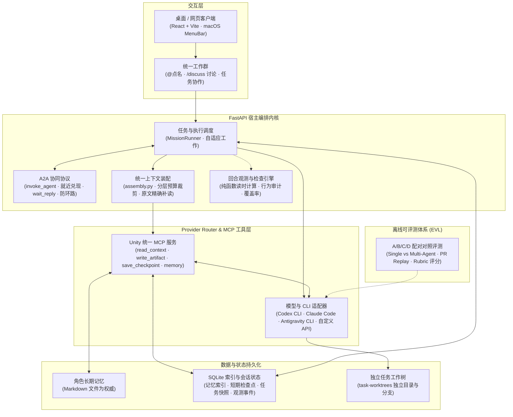

<p align="center"></p>

# Unity

**把平时用的几个 AI，放进同一个工作群里。**

[](LICENSE)

中文 | [English](README_EN.md)

> 4 月的时候，我手上开着好几个 coding agent 终端，在做一个真实需求：A 来写方案，B 来开发，C 审一下。
> A 写好方案文件，我拿去交给 B；B 写完代码，我再告诉 C 代码在哪、帮忙看看。
> 就这样在几个聊天框之间复制粘贴，我觉得自己像个 router。

Unity 就是从那会儿开始做的：把 Codex CLI、Claude Code、Antigravity 和模型 API 接进同一个工作群，让几位性格不同的伙伴共享对话、记忆和产物，需要时互相接力。你说一句 `@谁`，剩下的传话交给他们。

目前住在这里的是张楚岚、冯宝宝和王也。

## 为什么做成这样

**不做"一个更强的 agent"。** 那条路是大厂的主场，一个独立开发者去硬碰，有点像 V 对上荒坂。Unity 做的是大厂不会替你做的事：跨厂商编排。Claude Code 不会去调度 Codex，Codex 也不会反过来调度 Claude Code，Unity 站在它们中间。

**伙伴有性格，是为了有温度。** 张楚岚通透机敏，宝宝坦率好奇，王也松弛笃定。我想要的气场是一间简约、有温度的工作室：熟人各忙各的，随口搭句话都接得上。

## 用起来是什么样

**先聊聊。** 在输入框里选中 `@张楚岚`，说说你想做的事，需求没想好也没关系。想听几个人的看法就同时点名几位；开启讨论扩展后也可以用 `/discuss`，大家先各自独立回答，有分歧再交流，需要你取舍的地方会单独留下来。

**想好了，再开始做。** 开启任务扩展后，可以让伙伴整理一份任务提议：谁负责、做什么、做到什么程度算完成。你确认后任务才开始，每项新任务有自己的分支和代码目录。涉及数据、权限等风险的改动，会要求另一位伙伴审核。

**回来看看结果。** 交付的文档、页面和图片可以直接打开，也能启动独立预览。中途卡住了会留下原因，已经保存的文件也还在。

默认的 Unity 只做最核心的一件事：伙伴共享对话、记忆和产物，互相接力。讨论、任务和仓库维护是可选扩展，在「设置 → 扩展」里按需开启。

## 项目架构



### 核心机制实现

- **A2A 协同协议（Agent-to-Agent）**：基于统一 MCP 工具 `invoke_agent` 实现伙伴之间的动态接力。支持单向移交（`fire_and_forget`）与带唤醒恢复栈的双向求助（`wait_reply`）。宿主在调度时对委派实行“就近兑现”，内置调用链防环检测与深度预算控制；在自主任务中自动沉淀为持久化子任务与非自审约束。[详见 A2A 协议规范](docs/A2A_PROTOCOL.md)。
- **统一上下文装配（Context Management）**：由 `backend/app/memory/assembly.py` 统筹全局装配，杜绝全量历史无脑堆砌。按固定优先级与字符预算分层注入：未确认模型交接 → 长期记忆摘要 → 会话滚动检查点 → 对话与产物清单；配套 `read_context(message_ids=[...])` 原文补读机制，按需精准展开。[详见上下文记忆](docs/CONTEXT_MEMORY.md)。
- **长期记忆与检查点（Memory）**：“文件为权威，SQLite 存派生索引”。角色长期记忆以独立 Markdown（带 YAML frontmatter）原子落盘；SQLite 仅维护检索索引与短期滚动检查点（`save_checkpoint`），支持一键 `sync`/`rebuild` 自愈重建；角色可自主新增、按版本修订及安全遗忘条目。[详见上下文记忆](docs/CONTEXT_MEMORY.md)。
- **回合观测与链路追踪（Trace / Observability）**：以“回合（Turn）”为第一判定单位（任务太大、单步太碎）。所有事件（CLI 原生工具、MCP 活动、A2A 委派、产物写入、Token 消耗）按回合聚合折叠。检查规则为纯函数“读时计算、不落库”，实时评估 `claims_match_events`（回复与行为一致性）、工具错误重试与阻塞说明，并提供全局跨会话 Trace 覆盖率与成本透视。[详见回合观测](docs/OBSERVABILITY.md)。
- **离线多 Agent 评测（EVL / Evaluation）**：不盲目预设“多 Agent 一定更好”，而是回答在哪些任务更优、哪些任务反而更差。设计严格的 A/B/C/D 配对对照实验（单 Agent / 自我反思 / 固定流水线 / 动态 A2A），结合闭卷题集与真实 PR 回放（PR Replay），基于客观 Rubric 评分，量化 Token、延迟、成本、观点冗余度（Jaccard 相似度）与信息损耗。[详见评测实验](docs/EVALUATION.md)。

## 进度

做完一项打一个勾，🚧 表示正在做。

- [x] 多位伙伴共享对话、记忆和产物，@ 点名、互相接力
- [x] A2A 协议：通过 `invoke_agent` 实现单向接力与 `wait_reply` 双向唤醒，内置防环路与深度预算
- [x] 上下文分层装配：模型交接 + 长期记忆 + 滚动检查点预算裁剪，支持按需精确补读
- [x] 长期记忆与检查点：文件权威落盘、SQLite 派生索引自愈重建，记忆可查可改可回溯
- [x] 回合观测（Trace）：以回合为单位捕获原生与 MCP 工具活动，纯函数读时检查，全局成本与覆盖率大盘
- [x] 离线评测（EVL）：A/B/C/D 对照实验框架、闭卷基准题集与 Rubric 加权评分
- [x] 角色和模型分开配置，接 Codex / Claude Code / Antigravity CLI 和自定义 API
- [x] macOS 安装包（预览版，未公证，只有 Apple 芯片）
- [ ] 🚧 真实仓库 PR 回放评测（PR Replay 评测集扩充与自动化运行）
- [ ] 🚧 讨论扩展 `/discuss`：能用，默认关闭
- [ ] 🚧 任务扩展：独立分支和目录、预览、交付都有，但执行还是串行，长任务接续和失败恢复不够顺
- [ ] 🚧 选择任意项目仓库：桌面版菜单有入口，网页版还没有；已有会话切换仓库还有 bug（#63）
- [ ] 按预算自动挑选模型组合：同一件事，在不同成本下找到最合适的伙伴和模型搭配
- [ ] 任务并行执行

## 先跑起来

### macOS：下载安装包

1. 在 [Releases](https://github.com/Buaixihongshi/Unity/releases) 下载最新的 `Unity-<版本>-arm64.dmg`。目前只提供 Apple 芯片（M 系列）版本，需要 macOS 12 或更高版本。
2. 双击打开 dmg，把 Unity 拖进“应用程序”。
3. 预览版还没有经过 Apple 公证，第一次打开前先在终端执行一次：

   ```bash
   xattr -dr com.apple.quarantine /Applications/Unity.app
   ```

4. 从“应用程序”或启动台打开 Unity，窗口出现后按下面的首次引导接入 CLI。

桌面版自带运行环境，不用另装 Python 或 Node。它会读取登录 shell 的 PATH，通过 nvm、Homebrew 等方式安装的 CLI 也能找到。

- 数据在 `~/Library/Application Support/Unity/`，伙伴的工作目录是其中的 `workspace/`。日志在 `~/Library/Logs/Unity/backend.log`。菜单“Unity › 打开数据目录 / 显示后端日志”可以直接打开这两个位置。
- 使用 Workflow（自主开发）前，先在菜单“Unity › 选择项目仓库…”中选一个 Git 仓库。每个任务会在仓库里新建 `codex/task-…` 分支，工作树放在数据目录的 `task-worktrees/` 下。没有选择仓库时，对话和讨论照常可用，Workflow 任务会提示先选择仓库。
- 退出时如果还有任务在进行，会先请你确认。
- 卸载时删除 `/Applications/Unity.app`；如果不再需要数据，再删除上面的数据目录。
- 想自己打包，请看 [macOS 打包说明](packaging/macos/README.md)。

### 从源码运行

准备 Python **3.11+**、Node.js **20.19+ 或 22.12+** 和 npm。开发时推荐 Python 3.12、Node 22。

```bash
git clone https://github.com/Buaixihongshi/Unity.git Unity
cd Unity
./scripts/start.sh
```

脚本会安装依赖、启动前后端，然后打开 [本地页面](http://127.0.0.1:5173/)。

**首次启动会先接入一个真实 CLI。** 引导会检测本机的 Codex CLI、Claude Code 和 Antigravity CLI；确认已登录后，张楚岚用它完成第一次真实对话，再让三位伙伴使用同一连接。还没有安装时，页面会给出安装和登录说明。之后可以在设置里为每位伙伴换用其他连接与模型。

| 连接 | 现在能做什么 |
| --- | --- |
| Codex CLI、Claude Code、Antigravity CLI | 对话、讨论、工具协作，以及受限环境中的开发与验证 |
| 自定义 API | 文本对话和结构化讨论；支持 OpenAI Responses、Chat Completions、Anthropic 协议 |
| 演示模式 | 仅用于离线测试和显式 `--demo` 开发环境，不调用模型 |

真实连接会使用对应账号的额度，CLI 需要在本机安装并登录。当前讨论的真实 CLI 隔离和自主开发依赖 macOS，其他平台可以先体验演示和可用的对话能力。

## 技术栈与实现

前端用 React、TypeScript 和 Vite，后端用 FastAPI 和 SQLite。CLI 通过 MCP 读取上下文、发言、交付文件和邀请其他角色，宿主记录任务和执行结果。

会话、记忆和文件主要留在本机。使用真实模型时，请求内容仍会发送给你选择的服务。

## 文档

| 想了解什么 | 从这里看 |
| --- | --- |
| 伙伴的性格和讨论方式 | [角色](docs/PERSONALITIES.md) · [讨论技能](docs/ROUNDTABLE.md) · [活人感是删出来的](docs/notes/making-partners-feel-alive.md) |
| 多 Agent 协作与 A2A 协议 | [A2A 协同协议](docs/A2A_PROTOCOL.md) · [自主工作](docs/AUTONOMOUS_WORK.md) |
| 记忆与模型切换 | [上下文记忆](docs/CONTEXT_MEMORY.md) |
| 执行过程与对照实验 | [回合观测与 Trace](docs/OBSERVABILITY.md) · [评测 (EVL)](docs/EVALUATION.md) |
| 参与开发、检查和发布 | [贡献指南](CONTRIBUTING.md) · [开发环境](docs/ENVIRONMENTS.md) · [发布与恢复](docs/RELEASING.md) |

欢迎提 issue，也欢迎聊聊你希望几个 AI 一起做些什么。

Unity 采用 [MIT License](LICENSE)。
