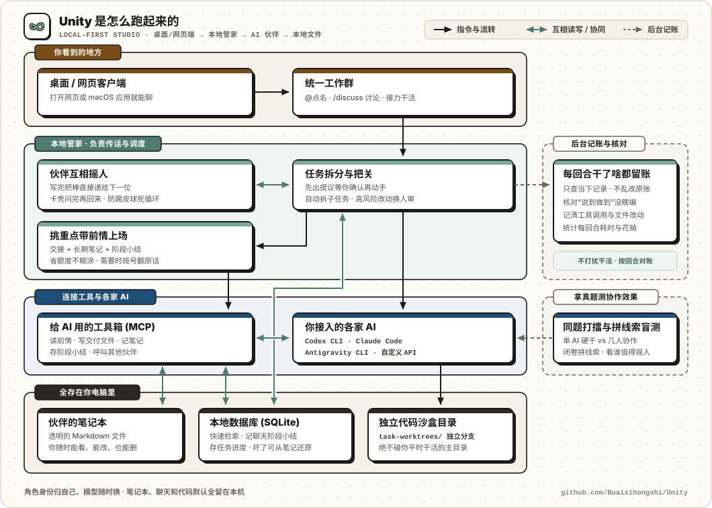
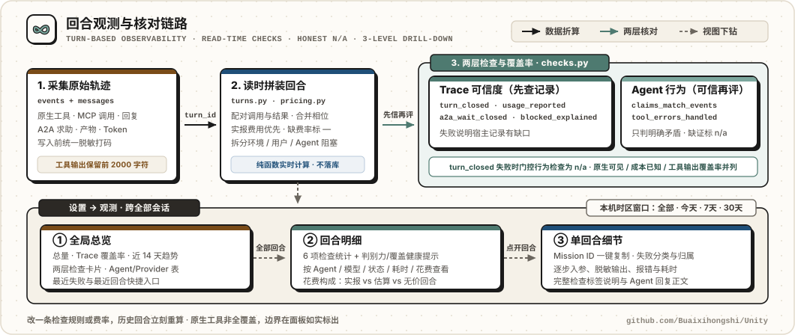
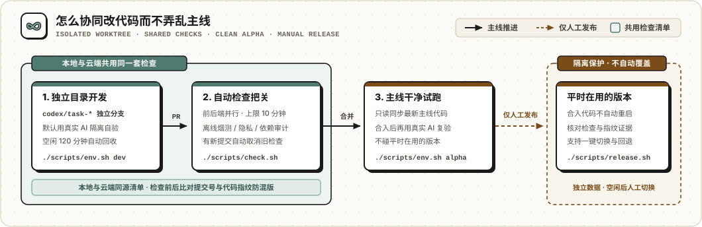

<p align="center"></p>

# Unity

**把平时用的几个 AI，放进同一个工作群里。**

[](LICENSE)

中文 | [English](README_EN.md)

> 4 月的时候，我手上开着好几个 coding agent 终端，在做一个真实需求：A 来写方案，B 来开发，C 审一下。
> A 写好方案文件，我拿去交给 B；B 写完代码，我再告诉 C 代码在哪、帮忙看看。
> 就这样在几个聊天框之间复制粘贴，我觉得自己像个 router。

Unity 就是从那会儿开始做的：把 Codex CLI、Claude Code、Antigravity 和模型 API 接进同一个工作群，让几位性格不同的伙伴共享对话、记忆和产物，需要时互相接力。你说一句 `@谁`，剩下的传话交给他们。

目前住在这里的是张楚岚、冯宝宝和王也。

## 为什么做成这样

**不做"一个更强的 agent"。** 那条路是大厂的主场，一个独立开发者去硬碰，有点像 V 对上荒坂。Unity 做的是大厂不会替你做的事：跨厂商编排。Claude Code 不会去调度 Codex，Codex 也不会反过来调度 Claude Code，Unity 站在它们中间。

**伙伴有性格，是为了有温度。** 张楚岚通透机敏，宝宝坦率好奇，王也松弛笃定。我想要的气场是一间简约、有温度的工作室：熟人各忙各的，随口搭句话都接得上。

## 用起来是什么样

**先聊聊。** 在输入框里选中 `@张楚岚`，说说你想做的事，需求没想好也没关系。想听几个人的看法就同时点名几位；开启讨论扩展后也可以用 `/discuss`，大家先各自独立回答，有分歧再交流，需要你取舍的地方会单独留下来。

**想好了，再开始做。** 开启任务扩展后，可以让伙伴整理一份任务提议：谁负责、做什么、做到什么程度算完成。你确认后任务才开始，每项新任务有自己的分支和代码目录。涉及数据、权限等风险的改动，会要求另一位伙伴审核。

**回来看看结果。** 交付的文档、页面和图片可以直接打开，也能启动独立预览。中途卡住了会留下原因，已经保存的文件也还在。

默认的 Unity 只做最核心的一件事：伙伴共享对话、记忆和产物，互相接力。讨论、任务和仓库维护是可选扩展，在「设置 → 扩展」里按需开启。

## 和其他项目有什么不同

常被问到：DeepSeek 有了自己的 agent 框架，OpenClaw、Hermes 也能换着接各家模型，Orca 能同时跑一群 coding agent，Unity 还有什么不一样？

一句话：**Unity 不替你挑一个最强的 agent，而是让你已经在用的几家 CLI 在同一个群里各当一个角色。** 讨论时先各自作答，分歧留下来；动手前先等你确认，有风险的改动换一位伙伴审。

### 同样是"一组 AI 一起干活"

| | 它是什么 | 用哪些 AI | 怎么协作 | 记忆 | 在哪用 |
| --- | --- | --- | --- | --- | --- |
| **Unity** | 本机运行的多角色工作群 | Codex CLI、Claude Code、Antigravity CLI，自定义 API；每位伙伴单独选连接和模型 | @ 点名、互相接力；`/discuss` 先独立作答再交流，综合稿交回参与者复核；任务先提议，你确认后才开始 | 每位伙伴有本地 Markdown 长期记忆，设置里能看、能改、能忘；会话有短期检查点 | 本机网页、macOS 应用 |
| [Tobs](https://github.com/BotHarness/DeepSeekBot) | 跑在 DeepSeek Harness 里的 bot 团队插件 | DSH 里配置的模型服务商 | 群聊里需要谁就 @ 谁；大任务委派给单个 Bot，做完交回报告 | 每个 Bot 的记忆是一个 Git 仓库，能翻看、修改、跨电脑同步 | DSH 桌面端；Slack、Discord、飞书、QQ、微信 |
| [DS Bot](https://github.com/Fei2411/DS-Bot) | DeepSeek Harness 的 bot 插件，也有自带 DSH 的桌面应用 | DeepSeek（经 DSH） | 主 Bot 管理其他 Bot 和群聊；群管理员默认回复、按需叫人；大目标分阶段、按证据验收 | 每个 Bot 有记忆，群聊另有自己的记忆 | 桌面应用、DSH 插件、Docker |

最大的区别在底座：Tobs 和 DS Bot 的每个 Bot 都跑在 DSH 上；Unity 的几位伙伴可以分别是不同厂商的 CLI。

### 相邻的项目

| | 它是什么 | 和 Unity 差在哪 |
| --- | --- | --- |
| [DeepSeek Harness](https://github.com/deepseek-ai/deepseek-harness) | DeepSeek 官方开源 agent 框架，一切皆插件，目前是开发者预览 | 它是造 agent 的底座，Tobs、DS Bot 都建在它上面；Unity 是把现成 CLI 组织起来的协作层，不在一层 |
| [OpenClaw](https://github.com/openclaw/openclaw) | 跑在自己设备上的个人助手，接 20 多个聊天渠道，模型和 agent harness 可以换 | 它是一个随处找得到的助手，引擎可换；Unity 是几位身份不同的伙伴在群里分工、互相把关 |
| [Hermes Agent](https://github.com/NousResearch/hermes-agent) | 会自我改进的个人 agent，自己整理记忆、从经验里生成技能，可派生子 agent 并行 | 它围绕一个人越用越懂你；Unity 关注伙伴之间的分工、分歧和交叉审核 |
| [Orca](https://github.com/stablyai/orca) | 多 coding agent 编排应用：协调 agent 拆活，worker 在各自 worktree 并行，带 diff 审阅和手机端 | 并行写代码、远程和手机端都比 Unity 成熟；Unity 执行还是串行，重心在讨论、确认和换人审 |

### 怎么选

想要一个在聊天软件里随时找得到、越用越懂你的个人助理，OpenClaw 和 Hermes Agent 更成熟；主要写代码，想让几个 agent 并行跑、在手机上盯进度，选 Orca；只用 DeepSeek，想要一队有长期记忆的 bot，可以看看 Tobs 和 DS Bot。

如果你手上已经有好几家的 CLI，想让它们在一个群里讨论、分工、互相把关，每一步做了什么都查得到，可以试试 Unity。这些工具并不冲突，很多可以一起用。

Unity 现在还做不到的：没接 Slack、飞书这类聊天平台，也没有手机端；任务执行还是串行；没有定时任务；真实 CLI 隔离和自主开发依赖 macOS；自定义 API 只能做文本对话和讨论。

> 以上对比依据各项目 2026 年 11 月的公开 README，它们更新很快，写错了或过时了欢迎提 issue。

## 它是怎么跑起来的

如果把 Unity 比作一间本地工作室，里面的分工其实很简单：**你在群里发话，一个本地“管家”负责传话、整理前情、记账和看紧代码目录，几个 AI 各自接入后按分工干活。**

<picture>
  <source media="(prefers-color-scheme: dark)" srcset="docs/images/unity-architecture-dark.svg">
  <source media="(prefers-color-scheme: light)" srcset="docs/images/unity-architecture-light.svg">
  
</picture>

背后主要靠这几件实在事：

- **AI 之间怎么互相摇人**：你说一句 `@谁`，写完方案的伙伴可以直接把棒递给下一位；卡壳时也能先拉另一个伙伴问一句、等对方回话再接着干。本地管家会盯着调用链，防止两个 AI 互相踢皮球陷入死循环。
- **聊得长了怎么不糊涂、不费额度**：每次请 AI 开口前，管家不会把几百条历史记录一股脑全塞进去，而是只挑出“没交接完的事 + 长期笔记 + 当前聊天的阶段小结 + 最近几句对话”；真需要翻哪句原话，AI 再按编号精准调阅。
- **记忆放哪、怕不怕丢**：每个伙伴的长期记忆独立存成一本你看得见、改得动、也能删掉的**本地 Markdown 笔记本**，检索索引坏了能从笔记本重建；聊天记录、阶段小结和任务进度保存在本地数据库里，仍需自行备份。
- **自主改代码时怎么隔离、干完怎么对账**：启动已确认的自主开发任务后，Unity 会为**每项任务**准备独立分支和目录（同任务的伙伴共用目录，普通对话不会自动创建）；后台按回合查看已记录的工具活动、用量和估算费用，并提示部分发言与记录矛盾的地方（缺记录会标未知）。
- **怎么证明“多个 AI 一起干”不是噱头**：我们没靠感觉吹，而是真拿题测试过——
  - **同题打擂台**：同一批任务，分别让“单个 AI 硬干 / 自己检查两遍 / 固定流程接力 / 自由摇人”四组上场，对比质量、耗时和花销，看清到底哪类活值得叫人。
  - **“拼线索”闭卷盲测**：每人只拿一部分私密线索（共看同一份背景材料），通过多轮讨论交换信息，看能不能拼出唯一正解；测试时禁用并审计外部工具，一旦发现或无法排除工具调用（含个别 CLI 可能触发的联网搜索）整局作废。

<details>
<summary>想看底层实现细节与评测实测数据，点这里展开</summary>

- **伙伴接力（A2A）**：基于统一 MCP 工具 `invoke_agent` 实现单向移交（`fire_and_forget`）与带唤醒恢复栈的双向求助（`wait_reply`），由宿主“就近兑现”并限制深度、检测环路；自主任务中自动沉淀为子任务与“非自审”约束。详见 [A2A 协议规范](docs/A2A_PROTOCOL.md)。
- **上下文按需装配**：由 `backend/app/memory/assembly.py` 按固定优先级与字符预算分层注入（未确认模型交接 → 长期记忆摘要 → 滚动检查点 → 对话与产物清单），配套 `read_context(message_ids=[...])` 按需精确补读原文。详见 [上下文记忆](docs/CONTEXT_MEMORY.md)。
- **文件权威记忆与索引重建**：在长期记忆模块中，带 YAML frontmatter 的 Markdown 原子落盘为权威，SQLite 仅存其派生检索索引（支持一键 `sync`/`rebuild` 重建）；短期滚动检查点（`save_checkpoint`）及会话、消息、任务状态仍保存在 SQLite 中，角色可新增、按版本修订或安全遗忘。详见 [上下文记忆](docs/CONTEXT_MEMORY.md)。
- **回合观测与一致性核对（Trace）**：以“回合（Turn）”为单位聚合已捕获的 CLI 原生工具、MCP 活动、委派、产物与用量；检查规则为纯函数读时计算、不落库，做有限类型的启发式矛盾核对（`claims_match_events`，无事件证据标 `n/a`）、错误重试核对与估算成本统计（原生工具并非全覆盖，缺费率或零用量标未知）。详见 [回合观测](docs/OBSERVABILITY.md)。
- **同题对照评测（EVL）**：A/B/C/D 配对对照实验框架（单 Agent / 自我反思 / 固定流水线 / 动态 A2A），结合闭卷题集与真实 PR 回放，基于 Rubric 量化质量、Token、延迟、成本、观点冗余度与信息损耗。详见 [评测实验](docs/EVALUATION.md)。
- **私卡协作盲测（`clueeval` / HiddenBench）**：使用 [`scripts/run_clueeval.py`](scripts/run_clueeval.py) 在 2 道自制题（`q1-storage`、`q2-rootcause`）与 HiddenBench 第 9 题 `hb-009-critical_hospital_transfer`（英文原题与中文译版 `zh-1`）上测试信息不对称协作，覆盖直连轮流（`direct-cli-round-robin`）与 Unity 编排（`unity-orchestrated`）双模式，并通过拆分答案与事件流禁工具审计防作弊。
  - 实测边界：在直连 CLI 层的 `formal-20261109-1` 批次（每题仅 2–3 局有效样本）中，信息分散时多轮讨论将单席准确率从 0%–22% 提至 100%（另有 `smoke-real-140b` 英文 `hb-009` 1 局 25%→100%、编排层 `orch-fixed-game-1` 的 `q1-storage` 1 局 0%→100%）；但在信息集中的 `solo_full` 基线（仅中文题）上单人同样达到 100% 且更快、“更省”仅覆盖已记录的 Claude 部分费用（其余 CLI 费用缺失）。上述直连批次不足以下统计显著结论，也不能外推 Unity 编排或全信息场景优势；英文原题与中文译版成绩不可直接比较。HiddenBench 4 席编排批次与多局对比待补跑；各 CLI 仍会读取用户级全局指令文件且禁用规则并非文件系统隔离，Antigravity 联网拦截（#145）仍依赖事件流检测事后作废。完整批次记录与详细限制见 [私卡评测说明](eval/clueeval/README.md)。

</details>

## 回合观测：每轮干了啥都能对账

在群里让几位 AI 一起干活，最怕两件事：一是只看到最后一句回复，中间调用了什么工具、卡在哪一步一团黑；二是花了多少钱、到底是 AI 自己没干好还是网络/限额挂了分不清。打开 **设置 → 观测**，可以看到跨全部会话的实时运行账本（支持按本机时区切换 **全部 / 今天 / 7 天 / 30 天** 窗口）。

<picture>
  <source media="(prefers-color-scheme: dark)" srcset="docs/images/unity-observability-dark.svg">
  <source media="(prefers-color-scheme: light)" srcset="docs/images/unity-observability-light.svg">
  
</picture>

- **按“回合”折算，三级下钻查细节**：单步事件太碎、整条任务又太粗，Unity 把事件按每次发言的**回合（Turn）**折叠。从 **全局总览**（总量、Trace 覆盖率、近 14 天趋势、Agent/Provider 对比与最近失败）可下钻到 **全部回合明细**，再点开 **单回合细节** 查看逐步入参、脱敏输出、报错、完整回复，并支持一键复制 `Mission ID` 排查。
- **先查“记录可不可信”，再评“伙伴做得对不对”**：检查分为 **Trace 可信度**（回合是否闭合、求助是否闭合、失败有没有可读原因、有产出是否报了用量）和 **Agent 行为**（声明与事件是否矛盾、工具报错是否重试或承认）两层。若连回合终态都缺失，行为层自动门控记为 `n/a`，不拿残缺证据乱给分。
- **不把“看不到”装成“零花费”或“没出错”**：`n/a` 是一等公民，面板把 **原生工具可见、成本已知、工具输出** 三项覆盖率与检查结果并列展示；费用有实报用实报、没报按粗估费率算，缺费率或用量为 0 时显示 `—`（未知），不写 `$0` 低估开销；检查长期从未失败或几乎全为 `n/a` 时，还会提示“可能没有判别力”或“覆盖不足”。
- **把环境问题和伙伴失误拆开**：失败和阻塞会按原因归属拆为 **Agent / 环境 / 用户**（网络、鉴权、配置、额度耗尽等算环境，手动停止算用户），Agent 列表中的“阻塞”只计伙伴自身原因，环境与用户原因单列在旁。

<details>
<summary>想看观测实现机制、6 项检查规则与当前边界，点这里展开</summary>

- **读时纯函数计算（不落库）**：`backend/app/observability/turns.py`、`checks.py`、`pricing.py` 与 `overview.py` 在每次读取时从 `events` 与 `messages` 实时重建回合、费率与评分，修改检查规则或费率后历史回合立刻重算，不留“旧分数”。
- **两层 6 项检查**：
  - `trace` 层：`turn_closed`（任务结束时回合有终态，作为行为层门控）、`a2a_wait_closed`（`wait_reply` 求助有唯一终态、真实回复与发起者续答）、`blocked_explained`（阻塞/失败有可读原因或回复承认）、`usage_reported`（有产出的非演示回合记录了非零用量）。
  - `agent` 层：`claims_match_events`（启发式抽取委派、产物、执行、完成声明及续答确认，仅在明确与事件矛盾时 fail，无事件证据记 `n/a`）、`tool_errors_handled`（非普通 shell 退出的工具失败已在后续恢复或在回复中承认）。
- **脱敏与接口**：工具参数与输出写入前过 `sanitize_tool_args` / `sanitize_tool_output` 打码，`output` 截断保留前 2000 字符；前端通过 `/api/observability/overview` 与 `/api/observability/turns/{turn_id}`（另有按任务查询的 `/api/observability`）读取同一套计算逻辑。
- **已知边界**：`claims_match_events` 重视精确率，只覆盖有限几类已完成声明；独立隔离的讨论（roundtable）回合，CLI 原生工具调用不进 `provider.activity`（原生可见率为 `0%`），属当前采集边界而非报错。完整说明见 [回合观测文档](docs/OBSERVABILITY.md)。

</details>

## 进度

做完一项打一个勾，🚧 表示正在做。

- [x] 多位伙伴共享对话、记忆和产物，@ 点名、互相接力
- [x] 伙伴互相摇人接力：写完能顺手交给下一位，卡壳还能问人再回来，不会无限踢皮球
- [x] 长对话按需拼装前情：优先带交接、长期笔记和阶段摘要上场，需要哪句再精准翻原话
- [x] 看得见的本地记忆：长期笔记存成 Markdown 文件，数据库索引坏了能一键重建
- [x] 回合记账与矛盾提示：按回合查看已记录的工具活动、用量和估算费用，提示部分发言与记录矛盾（缺记录标未知）
- [x] 实测“多 AI 值不值得用”：同题对比单干与协作，还有拼线索盲测验证分散信息能不能聊出正解
- [x] 角色和模型分开配置，接 Codex / Claude Code / Antigravity CLI 和自定义 API
- [x] macOS 安装包（预览版，未公证，只有 Apple 芯片）
- [ ] 🚧 真实仓库 PR 回放评测（拿真实开发任务扩充测试集、自动跑分）
- [ ] 🚧 讨论扩展 `/discuss`：能用，默认关闭
- [ ] 🚧 任务扩展：独立分支和目录、预览、交付都有，但执行还是串行，长任务接续和失败恢复不够顺
- [ ] 🚧 选择任意项目仓库：桌面版菜单有入口，网页版还没有；已有会话切换仓库还有 bug（#63）
- [ ] 按预算自动挑选模型组合：同一件事，在不同成本下找到最合适的伙伴和模型搭配
- [ ] 任务并行执行

## 先跑起来

### macOS：下载安装包

1. 在 [Releases](https://github.com/Buaixihongshi/Unity/releases) 下载最新的 `Unity-<版本>-arm64.dmg`。目前只提供 Apple 芯片（M 系列）版本，需要 macOS 12 或更高版本。
2. 双击打开 dmg，把 Unity 拖进“应用程序”。
3. 当前 DMG 尚未经过 Apple 公证，第一次打开前先在终端执行一次：

   ```bash
   xattr -dr com.apple.quarantine /Applications/Unity.app
   ```

4. 从“应用程序”或启动台打开 Unity，窗口出现后按下面的首次引导接入 CLI。

桌面版自带运行环境，不用另装 Python 或 Node。它会读取登录 shell 的 PATH，通过 nvm、Homebrew 等方式安装的 CLI 也能找到。

- 数据在 `~/Library/Application Support/Unity/`，伙伴的工作目录是其中的 `workspace/`。日志在 `~/Library/Logs/Unity/backend.log`。菜单“Unity › 打开数据目录 / 显示后端日志”可以直接打开这两个位置。
- 使用 Workflow（自主开发）前，先在菜单“Unity › 选择项目仓库…”中选一个 Git 仓库。每个任务会在仓库里新建 `codex/task-…` 分支，工作树放在数据目录的 `task-worktrees/` 下。没有选择仓库时，对话和讨论照常可用，Workflow 任务会提示先选择仓库。
- 退出时如果还有任务在进行，会先请你确认。
- 卸载时删除 `/Applications/Unity.app`；如果不再需要数据，再删除上面的数据目录。
- 想自己打包，请看 [macOS 打包说明](packaging/macos/README.md)。

### 从源码运行

准备 Python **3.11+**、Node.js **20.19+ 或 22.12+** 和 npm。开发时推荐 Python 3.12、Node 22。

```bash
git clone https://github.com/Buaixihongshi/Unity.git Unity
cd Unity
./scripts/start.sh
```

脚本会安装依赖、启动前后端，然后打开 [本地页面](http://127.0.0.1:5173/)。

**首次启动会先接入一个真实 CLI。** 引导会检测本机的 Codex CLI、Claude Code 和 Antigravity CLI；确认已登录后，张楚岚用它完成第一次真实对话，再让三位伙伴使用同一连接。还没有安装时，页面会给出安装和登录说明。之后可以在设置里为每位伙伴换用其他连接与模型。

| 连接 | 现在能做什么 |
| --- | --- |
| Codex CLI、Claude Code、Antigravity CLI | 对话、讨论、工具协作，以及受限环境中的开发与验证 |
| 自定义 API | 文本对话和结构化讨论；支持 OpenAI Responses、Chat Completions、Anthropic 协议 |
| 演示模式 | 仅用于离线测试和显式 `--demo` 开发环境，不调用模型 |

真实连接会使用对应账号的额度，CLI 需要在本机安装并登录。当前讨论的真实 CLI 隔离和自主开发依赖 macOS，其他平台可以先体验演示和可用的对话能力。

## 技术栈与实现

前端用 React、TypeScript 和 Vite，后端用 FastAPI 和 SQLite。CLI 通过 MCP 读取上下文、发言、交付文件和邀请其他角色，宿主记录任务和执行结果。

会话、记忆和文件主要留在本机。使用真实模型时，请求内容仍会发送给你选择的服务。

## 参与开发（给贡献者）

如果你想一起改代码、提 PR，Unity 用**“一项任务一个独立代码目录 + 本地与云端共用同一套检查清单 + 干净的主线试跑环境”**来防止多个 AI 把主线改乱、或误伤你平时在用的实例；具体规范见 [贡献指南](CONTRIBUTING.md) 与 [开发流程 SOP](docs/SOP.md)。

<details>
<summary>想看开发协作流程图与踩坑演进（worktree 隔离、门禁与发布边界），点这里展开</summary>

<picture>
  <source media="(prefers-color-scheme: dark)" srcset="docs/images/unity-ci-workflow-dark.svg">
  <source media="(prefers-color-scheme: light)" srcset="docs/images/unity-ci-workflow-light.svg">
  
</picture>

这套流程从轻量的主干开发（`main` + 短命 `codex/*` 分支 + PR Squash 合并）和 GitHub Actions 双路检查起步，结合多 Agent 协同开发的真实踩坑逐步演进：

1. **三套环境物理隔离（PR #12 → #23 → #174）**：用 `scripts/env.sh dev <task>` 为每项任务拉出独立 worktree、端口与 `.yiren/<profile>/` 状态，并发不打架；另有干净只读的 `alpha` 主线镜像做合后复验，平时在用的 `runtime` 仅人工显式切换。空闲 120 分钟自动回收，默认最多同时跑 4 个开发实例。
2. **本地与 CI 用同一把尺子（PR #22 → #23）**：所有检查收拢在 `scripts/checks.py`（7 个分组），本地 `scripts/check.sh` 与 GitHub Actions 共用；执行前后核对 `git_sha` 与 `source_digest`，测试途中改过代码直接判失败。
3. **离线确定性检查 vs 真实模型验收分开**：GitHub Actions 里只跑 `--fake` / `fixture` 烟测与评测，稳定不烧额度；`development` 与 `alpha` 继承日常 CLI 路由跑真实链路，上线前由 `scripts/release.sh` 校验证据链。
4. **给流程做减法（PR #29、PR #46）**：砍掉与 GitHub 原生 PR Review / Ruleset 重叠的独立 `Owner approval` 自定义 workflow；非 bug 改动不再强制先建 Issue，仅 bug 必须建 Issue 闭环。
5. **依赖审计可豁免但不腐化（PR #193）**：`scripts/audit_frontend.py` 配合 `config/audit-exemptions.json` 管理豁免，写清公告、原因、Issue 与撤销条件，上游修复后过期豁免会自动报错催删。

</details>

## 文档

| 想了解什么 | 从这里看 |
| --- | --- |
| 伙伴的性格和讨论方式 | [角色](docs/PERSONALITIES.md) · [讨论技能](docs/ROUNDTABLE.md) · [活人感是删出来的](docs/notes/making-partners-feel-alive.md) |
| 伙伴如何互相协作与自主干活 | [A2A 协同协议](docs/A2A_PROTOCOL.md) · [自主工作](docs/AUTONOMOUS_WORK.md) |
| 记忆与模型切换 | [上下文记忆](docs/CONTEXT_MEMORY.md) |
| 怎么看每步干了啥、效果怎么测 | [回合观测](docs/OBSERVABILITY.md) · [评测实验](docs/EVALUATION.md) · [私卡盲测 (clueeval)](eval/clueeval/README.md) |
| 参与开发、检查和发布 | [贡献指南](CONTRIBUTING.md) · [开发环境](docs/ENVIRONMENTS.md) · [发布与恢复](docs/RELEASING.md) |

欢迎提 issue，也欢迎聊聊你希望几个 AI 一起做些什么。

Unity 采用 [MIT License](LICENSE)。
