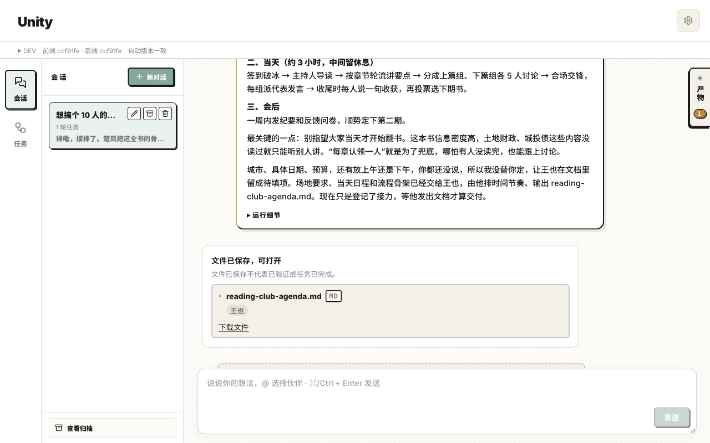
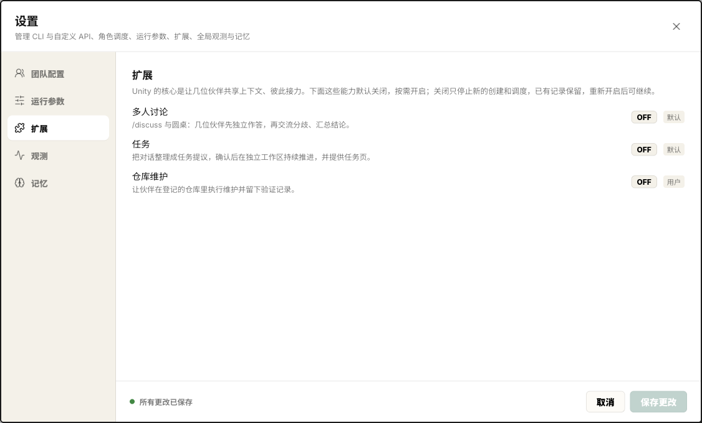
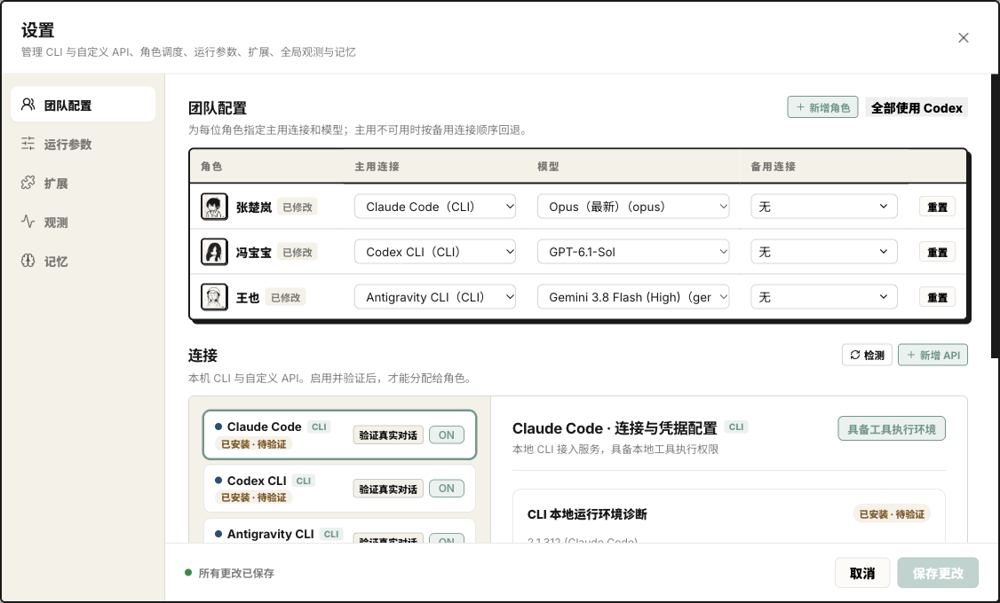
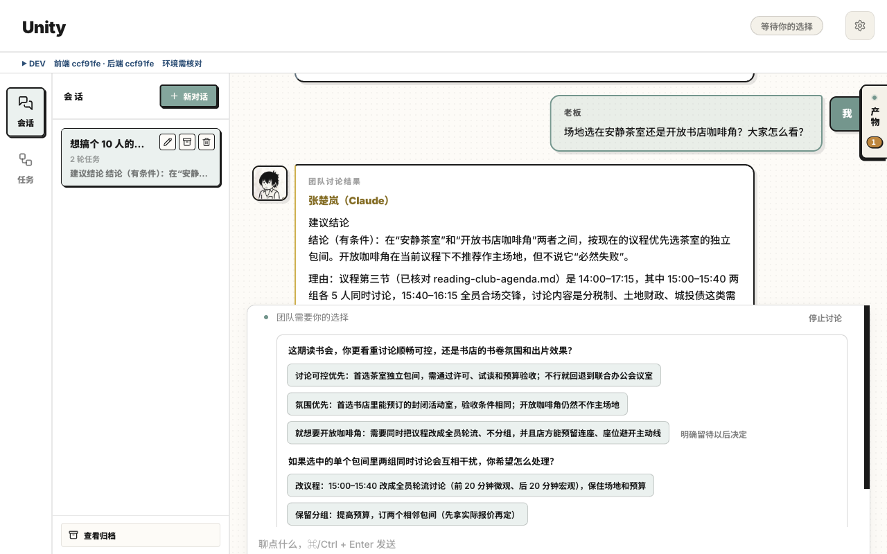
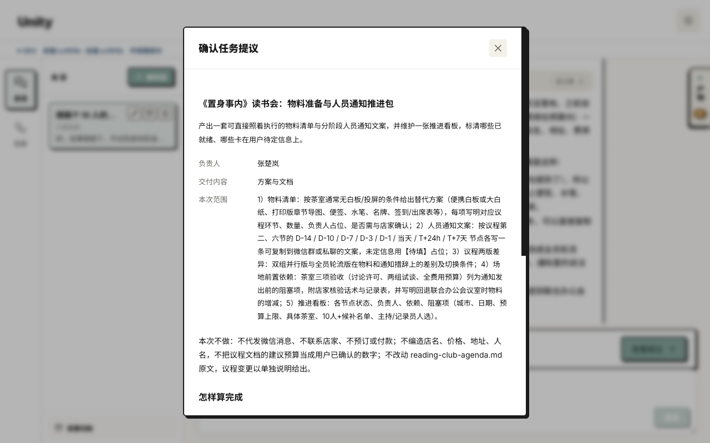
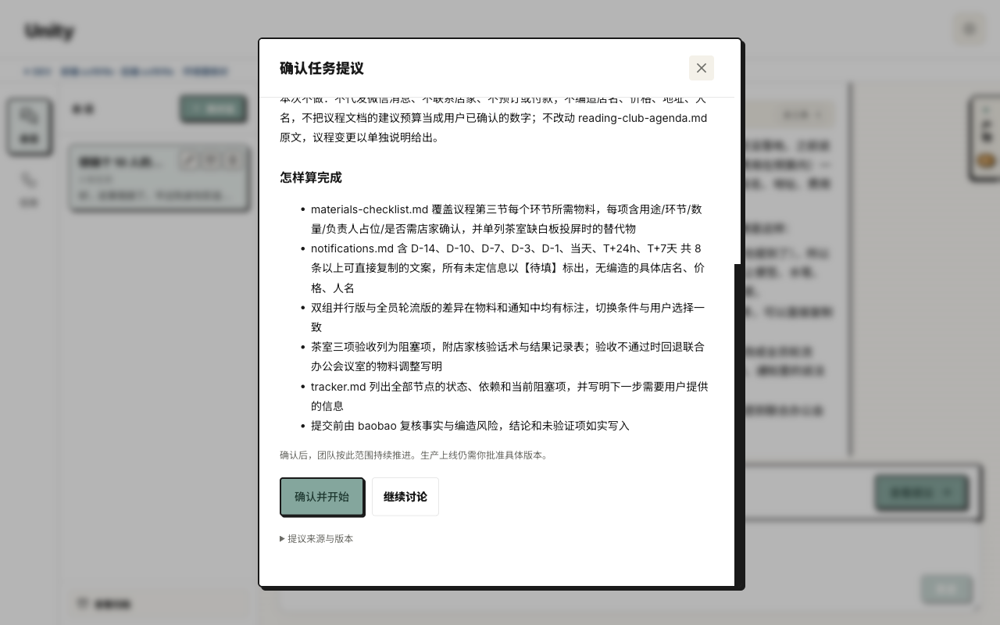
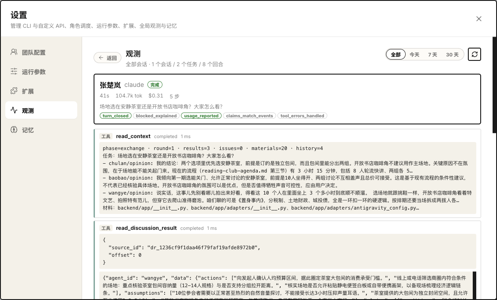
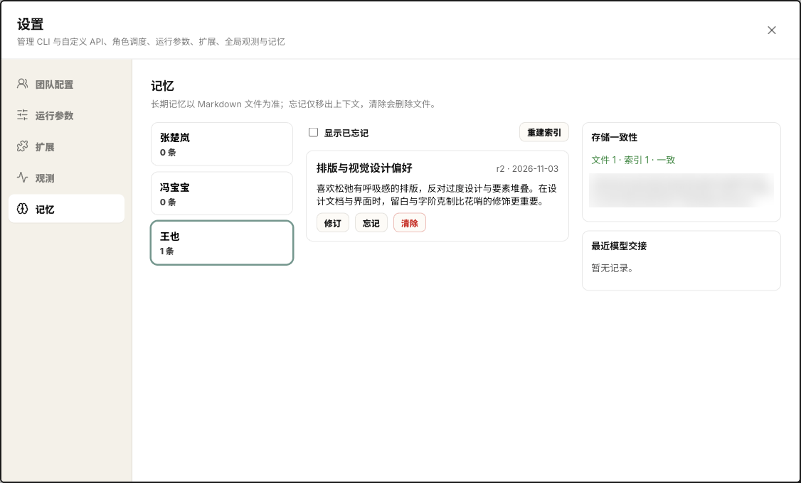

# Unity 产品文档 · 第 0–1 章

> 目前完成第 0–1 章，后续章节陆续补上。
> 素材来源：README、`docs/architecture/iron-laws.md`、近期 PR（#76、#77、#81、#82）。每条理念都对应一个现在已有的行为；还没做到的写在「目前的边界」里。

---

## 第 0 章 · Unity 是什么

### 一句话

把你平时用的几个 AI 放进同一个工作群：它们共享对话、记忆和产物，能互相接力、互相检查，你不用再在几个窗口之间来回传话。

### 它解决什么问题

你可能同时在用 Claude、GPT、Gemini，每个都有擅长的地方。但同时用它们，你就成了中间的"路由器"：复制粘贴上下文，记住谁说过什么，把结论从一个窗口搬到另一个窗口。

Unity 把这部分活接过来。几位伙伴各有稳定的身份和记忆，围绕同一个目标讨论、分工，你只需要说清想要什么，在关键的地方做决定。

*图 0-1 会话页：消息流与产物卡片*

### 住在这里的伙伴

| 伙伴 | 擅长 |
| --- | --- |
| 张楚岚 | 架构取舍、核心开发 |
| 冯宝宝 | 代码审查、安全 |
| 王也 | 视觉设计、创意 |

三个人都能分析问题、提方案、干活。上面只是各自更擅长的方向，具体谁来做看这件事需要什么。

### 默认有什么、可以加什么

- **核心（默认开启）**：几位伙伴共享同一份对话、记忆和产物，需要时互相接力。
- **扩展（默认关闭，在「设置 → 扩展」开启）**
  - 讨论扩展：`/discuss`，多人先独立回答再交流
  - 任务扩展：任务提议 → 你确认 → 执行 → 交付与预览
  - 仓库维护扩展

只用核心也能完整用起来。扩展按需开启，没打开的不会出现在界面里。

*图 0-2 设置 → 扩展*

### 适合谁

- 已经在用一两种 AI CLI（Codex CLI、Claude Code、Antigravity），想让它们协作的人
- 想让 AI 帮忙推进一件持续的事，同时希望关键决定自己拿的人
- 在意数据留在本机、过程能查清楚的人

### 暂时不适合

- 多人团队共用：Unity 目前是本地单用户应用
- 非 macOS 平台上的自主开发：真实 CLI 隔离和开发任务目前依赖 macOS，其他平台可以先体验对话
- 只想接模型 API、不装 CLI 也要做开发任务：API 连接目前只支持文本对话和讨论，开发执行需要 CLI

### 读这份文档的顺序

1. 第 1 章「设计理念」：先知道 Unity 为什么这样设计，后面遇到"怎么停下来了""怎么看不到别人的回答"时就有答案
2. 第 2 章「核心概念」：角色、连接、会话、记忆、产物、接力
3. 第 3 章「一个人用 Unity」
4. 第 4 章起：各扩展、信任与边界、配置、FAQ

---

## 第 1 章 · 设计理念

Unity 的很多行为乍一看像限制：会停下来等你、讨论时看不到别人的答案、伙伴说的话必须"正式发出来"才算数。它们背后是下面几条取舍。

每条按同样的格式写：**一句话 → 你会看到什么 → 目前的边界**。

---

### 1. 角色和模型分开

**伙伴的性格和职责是固定的，底下用哪个模型可以换。**

你会看到：

- 首次启动只需要接入一个 CLI，三位伙伴先共用这一个连接
- 在设置里可以给每位伙伴单独选连接、模型和备用连接
- 换了模型，张楚岚还是张楚岚：他的记忆和交接信息会带过去

目前的边界：

- 自定义 API 连接只能做文本对话和讨论，开发任务需要 CLI
- 不同模型的能力不一样，同一个角色换了模型以后，回答质量可能有差别

*图 1-1 设置 → 团队配置*

---

### 2. 先各自想，再交流（讨论扩展）

**多人讨论时先独立回答，有分歧再碰，避免大家跟着第一个发言的人走。**

你会看到：

- `/discuss` 的同一阶段里，伙伴们提交之前看不到彼此这一轮的回答
- 没有新内容时讨论会尽早收束，不为凑轮数硬聊
- 综合稿会交回原参与者复核；需要你拍板的分歧会单独列出来

目前的边界：

- 这只在讨论扩展里生效。普通对话里点名多位伙伴时，后发言的人能看到前面的回复

*图 1-2 讨论综合稿与待选择面板（未拍全全部选项）*

---

### 3. 关键决定留给你

**能自己推进的事，伙伴就推进；需要取舍或有风险的地方，停下来问你。**

你会看到：

- 任务开始前有一份任务提议（谁负责、做什么、做到什么程度算完成），你确认后才动手
- 涉及数据、权限等风险的改动，会要求另一位角色审核
- 上线必须你明确批准，并核对实际结果
- 对话进行中可以随时暂停，改了上一句话再重发，伙伴会知道哪些说法已经作废

目前的边界：

- 任务执行目前是串行的，一次推进一项

*图 1-3a 任务提议（上）*

*图 1-3b 任务提议（下）*

---

### 4. 说了就是真说了

**伙伴的回复必须正式发到会话里才算数。只在后台打印一句"我已经回复了"，不算。**

你会看到：

- 会话里显示的每一条伙伴发言，都是真实发出的消息
- 如果某一轮伙伴没有正式发言，会标成失败，不会拿后台输出凑一条假回复
- 伙伴之间的接力也走同样的正式通道，次数有上限、过程有记录；正文里提到某人的名字不会自动把他叫来

> 对应开发文档：铁律 L1、L3（`docs/architecture/iron-laws.md`）

---

### 5. 做过什么都能查

**就算一轮失败了，已经做完的部分也不会白费，你能看到卡在哪。**

你会看到：

- 伙伴登记的文件会单独显示，就算这一轮后来超时，也还能预览和下载
- 一轮超时后，页面上会有一段「宿主记录 · 非角色发言」，写着这一轮调用了哪些工具、交付了哪些文件、最后在做什么、为什么停下。这段话是系统记的，不是伙伴说的，也不会被当成伙伴说过的话带进后续对话
- 服务重启时正在进行的对话会被标为中断，已经发出的回复保留，并提示哪些伙伴原本还没轮到发言；不会自动重放，由你决定要不要继续
- 「设置 → 观测」可以看到每一轮用了哪个模型、调用了什么工具、有没有协作。费用有实际报价就用报价，估算会标出来，缺信息的就留空

目前的边界：

- 普通对话有单回合时限。大一点的开发需求，建议走任务提议，更适合接着推进

*图 1-5 设置 → 观测*

---

### 6. 记忆看得见、改得掉

**伙伴记住了什么，你随时能看、能改、能删。**

你会看到：

- 每位伙伴有自己的长期记忆，同一会话里还有短期检查点
- 记忆存成本地 Markdown 文件，可以在设置里查看、修改、忘记或清除
- 记错了就改掉；不想再带进对话的内容，可以移出去

*图 1-6 设置 → 记忆（路径已打码）*

---

### 7. 不动你的电脑设置

**Unity 用你本机的 CLI，但不改它们的全局配置。**

你会看到：

- 伙伴运行时用的是临时配置目录，你自己平时用的 Codex / Claude Code / Antigravity 设置不会被改
- 会话、记忆和文件主要留在本机，数据目录在菜单「Unity › 打开数据目录」里

目前的边界：

- 使用真实模型时，对话内容仍会发给你选择的模型服务

> 对应开发文档：铁律 L2
